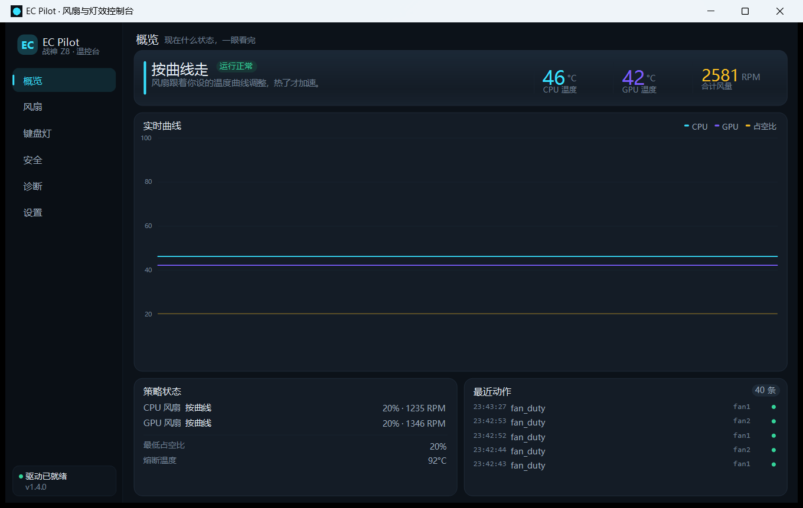
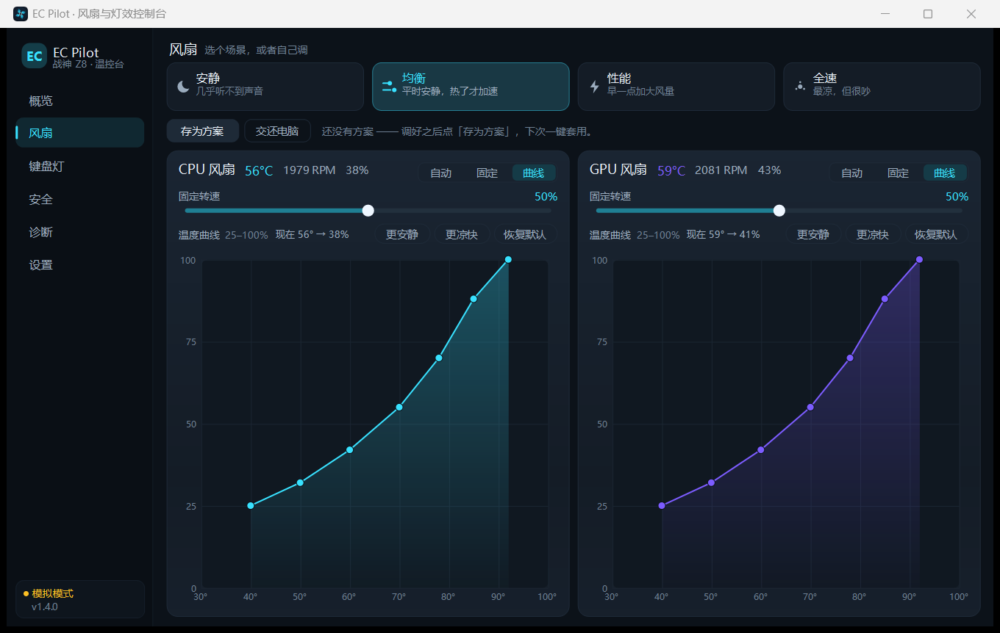
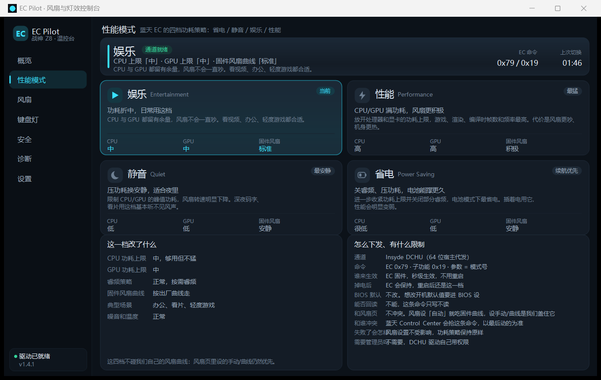

# EC Pilot · 蓝天模具风扇与键盘灯控制台

> 面向 **蓝天（Clevo / HASEE）NH5x-NH7x 模具** 的 Windows 原生风扇、性能模式与键盘灯控制程序。
> 不装第三方库、不套浏览器内核、不写 BIOS —— 一个 32 位进程直接与 EC（嵌入式控制器）对话。



---

## 这个项目解决什么问题

蓝天模具的 Control Center 功能分散、界面沉重，第三方工具（NBFC 等）又大多停留在"改寄存器"层面。
EC Pilot 想做的是：**把风扇这件事做成能长期挂在后台、出错能自己兜住的东西**。

- 界面用 wxWidgets 自绘，单进程常驻约 50–60 MB，关窗口收进托盘。
- 风扇、性能模式、键盘灯三套能力统一在一个面板里，配置改动即时生效。
- 所有硬件写入**先记账再动手**，退出、崩溃、断电都有对应的还原路径。

## 功能

| 模块 | 能力 |
| --- | --- |
| 概览 | CPU/GPU 温度环、转速、当前占空比、90 秒温度曲线、系统负载 |
| 风扇 | 每风扇三模式：自动（完全不写）/ 手动（滑杆定死）/ 曲线（拖点定义温度→风量） |
| 性能模式 | 省电 / 静音 / 娱乐 / 性能 四档，走 EC `0x79`+`0x19`，秒级生效、不改 BIOS 默认值 |
| 我的方案 | 把两只风扇的模式、转速和两条曲线存成方案，最多 12 个，一键套用 |
| 键盘灯 | 真彩 RGB：色相/饱和度/亮度、12 组预设、6 种灯效、试亮 8 秒 |
| 安全与还原 | 写入日志、一键还原、熔断温度、最低占空比、退出自动还原 |
| 诊断 | 驱动状态、EC 版本、寄存器实测值、EC RAM 只读地图、一键导出 JSON 报告 |
| 设置 | 开机自启（计划任务，不弹 UAC）、常驻开关、退出还原开关、数据目录入口 |

<p align="center">
  
  
</p>

## 安全设计（这部分比功能更重要）

控制风扇的软件，出事的方式往往不是"没生效"，而是"退不回去"。所以设计上做了这些约束：

- **只写 EC 运行时寄存器**，不写 BIOS、不刷固件、不改 CMOS。
- **先记账再动手**：每次写入把时间、对象、旧值、新值、结果记进 `data/journal.jsonl`；
  异常退出后下次启动会检测到未清账的会话并尝试还原。
- **两阶段退出**：先封禁新写入 → 等待在途事务 → 还原硬件 → 保存"全自动"配置 → 才标记会话干净。
  还原失败不会清除恢复记录，而是保留供下次重试。
- **熔断与下限**：温度触线立即 100%（绕过平滑和写入间隔）；最低占空比默认 20%，防误拖到停转。
- **失效不等于低温**：温度缺失/过期、转速异常时，程序选择**交还固件自动**，而不是按低温下发低风量。
- **单实例**：机器范围命名互斥，不会出现两个控制器同时抢 EC 端口。
- **本地接口收紧**：Bearer token 仅驻内存，校验 Host/Origin，危险操作不允许走 HTTP。

> 断电即回到固件默认策略——EC 里的风扇寄存器是易失的，这是最后一道兜底。

## 快速开始

### 方式一：直接运行发布版

下载 `ECPilot.exe`，双击即可。首次运行若被 SmartScreen 拦下（未购买代码签名证书），
点「更多信息 → 仍要运行」。程序会在 exe 同目录建 `data\` 存放配置、日志与还原记录。

### 方式二：从源码运行

```bat
:: 需要 32 位 Python（Ntport.dll 是 32 位 PE，64 位进程载不进去）
启动 EC Pilot.bat
```

脚本会优先使用 `runtime\py32\python.exe`，找不到则回退系统 `python`。

### 方式三：自己打包

```bat
:: 需要在同级目录准备 32 位构建环境：..\.build\py32build\python.exe
python tools\build_exe.py --output dist\ECPilot.exe
```

打包脚本会先校验 32 位 / PyInstaller / wxPython 可用，构建后统计包内 wx 扩展数量，
失败不会覆盖已有产物。

### 仓库里没有的东西

出于体积与版权考虑，以下内容**未随仓库分发**，需要自行准备：

| 缺失项 | 用途 | 怎么补 |
| --- | --- | --- |
| `drivers/`、`driver_setup/` | `Ntport.dll`、`ClevoEcInfo.dll` 与端口驱动 | 从本机 Control Center 安装目录提取，放到同名目录 |
| `runtime/py32/` | 内置 32 位 Python 3.11 | 装一份 32 位 Python 到该路径，或用系统 python 启动 |

打包配置 `ecpilot.spec` 会把这两个目录打进产物，缺目录时请先补齐再构建。

## 项目结构

```
ECPilot/
├─ app/
│  ├─ main.py            入口：自检 → 建后端 → 起引擎 → 起服务 → 开窗口 → 退出还原
│  ├─ server.py          本地 HTTP + SSE（带鉴权）
│  ├─ store.py           配置读写：校验、锁、原子保存
│  ├─ hardware/          ec.py 裸协议 · vendor.py 厂商 DLL · ntport.py 端口
│  │                     backend.py 选路降级 · conflicts.py 冲突进程 · dchu_bridge.py 64 位宿主
│  ├─ control/           engine.py 控制循环 · safety.py 记账与还原 · curve.py 曲线
│  │                     light.py 灯效 · perfmode.py 性能档 · autostart.py 自启
│  └─ ui/                shell.py 框架 · pages_*.py 各页面 · kit.py 绘图件 · theme.py 主题
├─ tools/                探针与构建脚本（ec_probe / restore / build_exe / make_release …）
├─ assets/               图标与版本资源
├─ docs/screenshots/     界面截图
├─ ecpilot.spec          PyInstaller 打包配置
└─ *.bat                 启动、提权启动、只读诊断、安装驱动、还原并退出
```

## 协议要点（给想深究的人）

从本机 `ClevoEcInfo.dll` 逆向，并与 `tuxedo-fan-control`、`ClevoECView` 交叉验证：

```
命令端口 0x66，数据端口 0x62

读 EC RAM : 0x66<-0x80 ; 0x62<-地址 ; 读 0x62
写 EC RAM : 0x66<-0x81 ; 0x62<-地址 ; 0x62<-数据
温度      : 0x66<-0x9E ; 0x62<-风扇号 ; 连读 3 字节
手动转速  : 0x66<-0x99 ; 0x62<-风扇号 ; 0x62<-占空比
交还自动  : 0x66<-0x99 ; 0x62<-0xFF  ; 0x62<-风扇号

EC RAM：0xC8=风扇数量  0xD0/0xD1=CPU 转速  0xD2/0xD3=GPU 转速  0xD4/0xD5=第二颗 GPU 风扇
```

三条实测结论（不是推测，代码里按此实现）：

1. `0x99` 是 **8 位正向占空比**：`0`=停转、`254`=满速、`255`=交还固件。量程是 0–255，不是 0–100。
2. `0xD0/0xD1` 存的是**转速计周期计数**，与转速成反比，不是 RPM；界面按 `转速 ≈ 2200000 / 计数` 换算显示。
3. 自己拼的 `0x80` 读 RAM 时序在这类 EC 上不可靠；只要厂商 DLL 可用，轮询就走 DLL。

更多细节（含实测转速/温度对照表、键盘灯分区为什么无效）见 [使用说明.md](使用说明.md)。

## 已知限制

- 协议链路只在 **NH5xRC** 上完整验证过；换机型请先跑 `只读诊断.bat` 确认读数合理，再动风扇。
- GPU 温度取自 EC 传感器索引 2，与 NVIDIA 核心温度可能差 2–5 °C；风扇策略用的是 EC 值（与固件一致）。
- 性能档**只能写不能读**：EC 没有对应读取子功能，"当前档位"由程序自己记录，重装或改过 BIOS 后会显示「未知」。
- `0x66/0x62` 没有抢占机制：与 Control Center / NBFC 同时开启会互相打断，界面会检测并提示关闭。
- 若在一次 EC 事务中被**强制结束进程**，端口驱动可能卡死，只能重启电脑恢复；正常退出不受影响。
- 本仓库未声明开源许可证，默认保留所有权利。

## 免责声明

修改 EC 寄存器、风扇转速与功耗策略存在硬件风险，**请自行评估并承担后果**。
本项目按现状提供，不保证适配你的机型；出现异常请优先使用「还原全部」或直接断电重启。

## 版本

当前版本 **1.4.2**（`app/version.py`）。1.4.x 的主要工作集中在长期后台运行的可靠性：
失温/过期样本不再被当作低温、熔断绕过平滑与写入间隔、退出两阶段清账、性能桥超时隔离、
休眠代际保护、单实例与接口鉴权、隐藏窗口降频、日志滚动与恢复日志压缩。
